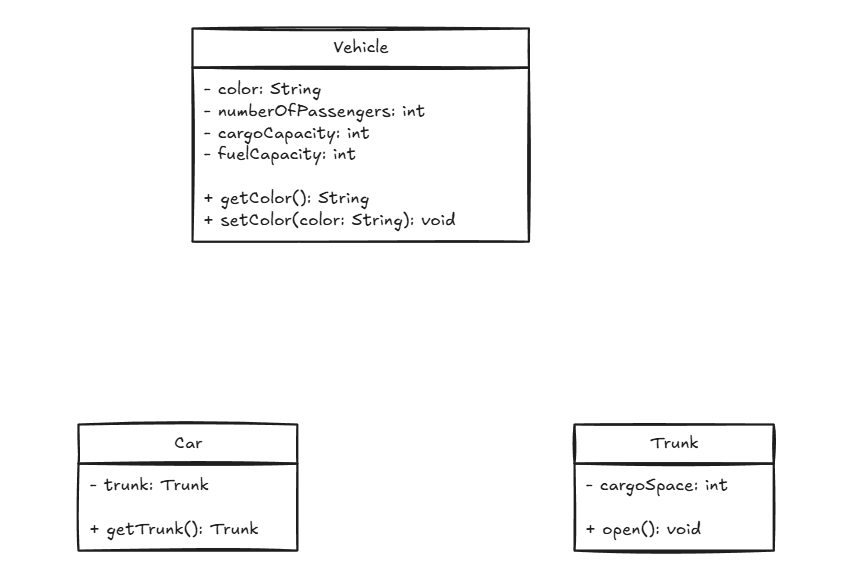

# Vehicle Inheritance

A small Java project for practicing inheritance. There is one parent class, `Vehicle`, and four child classes that extend it: `Moped`, `Car`, `SemiTruck` and `Hovercraft`. The `main` method makes one of each, fills in their details and prints them.

## The classes

`Vehicle` holds what every vehicle has:

- `color` (String)
- `numberOfPassengers` (int)
- `cargoCapacity` (int)
- `fuelCapacity` (int)

Each child extends `Vehicle`, so it gets those four fields and their getters and setters without any new code. Each child then adds three fields that only it has:

| Class | Its own fields |
|---|---|
| `Moped` | `basketIncluded`, `helmetColor`, `kickstandIncluded` |
| `Car` | `numberOfDoors`, `sunroofIncluded`, `trunkSizeCubicFeet` |
| `SemiTruck` | `trailerLengthFeet`, `sleeperCabIncluded`, `numberOfAxles` |
| `Hovercraft` | `numberOfJets`, `skirtColor`, `waterCapable` |

Anything that every vehicle has lives in `Vehicle`, and anything only one kind has lives in that child. That way I don't repeat myself.

## Exercise 2 and Exercise 3

**Exercise 2** had no constructors. I made each object with `new Moped()` and then used the setters to fill in everything.

**Exercise 3** added constructors. `Vehicle` now has a constructor that takes the color, passengers, cargo capacity and fuel capacity. Each child has its own constructor that takes those same four values and passes them up with `super(...)`. Now I can write `new Moped("Red", 1, 0, 5)`, and the setters are only needed for each child's own fields.

What I learned from Exercise 3: once `Vehicle` has a constructor with parameters, a child class can't extend it unless the child's constructor calls `super(...)`. Without that, IntelliJ shows an error.

## How to run it

Run `Main`. It creates a moped, a car, a semi truck and a hovercraft, prints all the details for each one, and then changes a few values with the setters and prints those to show the setters work.

## Excalidraw
